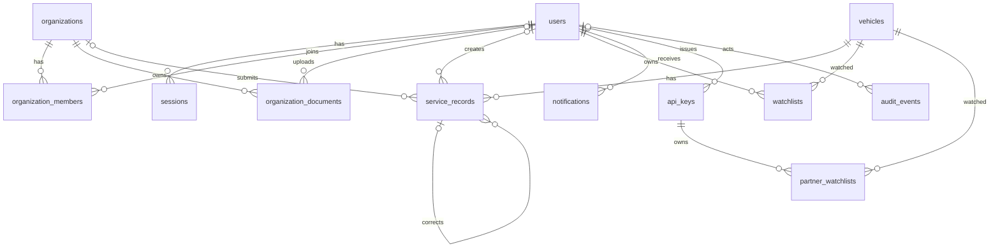

# Sijil architecture and interface contracts

**Status:** accepted architecture baseline for BU-01

**Last updated:** 19 November 2026

**Owners:** technical lead for cross-cutting changes; feature owners for their modules

This document is the decision record for repository boundaries, runtime topology, data ownership, the HTTP API and the browser WebSocket protocol. The generated FastAPI OpenAPI document is the field-level source of truth for HTTP request and response schemas. [`contracts/websocket.asyncapi.json`](../contracts/websocket.asyncapi.json) is the machine-readable source of truth for WebSocket messages.

Changing an externally visible route, response, event name or event payload requires all of the following in the same pull request:

1. Update the relevant Pydantic schema or AsyncAPI message.
2. Update this document if the change affects a decision or boundary.
3. Update the typed frontend client and contract/integration tests.
4. Preserve the existing version or introduce a new version; do not silently break clients.

## 1. Architectural decisions

- Use a **modular monolith**, not microservices: one FastAPI process owns business rules and one React SPA owns the browser UI.
- Expose a single HTTPS origin through Caddy. The browser never calls PostgreSQL, Redis or MinIO directly.
- Keep PostgreSQL as the system of record. MinIO stores private organisation documents; Redis carries transient pub/sub messages and Celery jobs. Redis is never the source of truth.
- Keep service history append-only. A correction is a new record linked to the original, never an edit or deletion.
- Authenticate the browser with a server-side session referenced by a secure cookie. The partner API uses separate, hashed API keys and is read-only for vehicle history.
- Use REST for durable state and WebSocket events as **invalidation hints**. After reconnecting or receiving an event, the client refetches authoritative REST state.
- Run without outbound internet access. Optional vPIC enrichment may improve a VIN result but can never block lookup or startup.
- Use only fictional demo data and never imply official UAE, insurer, manufacturer or government verification.

## 2. Selected stack

| Layer | Technology | Responsibility |
| --- | --- | --- |
| Web UI | React, Vite, TypeScript | Consumer, workshop and admin experiences |
| Styling | Tailwind CSS | Responsive design and complete Arabic RTL mirroring |
| API | Python, FastAPI, Pydantic | HTTP/WS boundary, validation and authorization |
| Domain/data | SQLAlchemy 2, Alembic | Transactions, relational models and migrations |
| Database | PostgreSQL | Durable application and audit data |
| Object storage | MinIO | Private organisation licence/trade documents |
| Jobs | Celery, Redis | Slow/background work; jobs must be retry-safe |
| Real-time | FastAPI WebSockets, Redis pub/sub | Per-user notifications and per-VIN timeline invalidation |
| Edge | Caddy | TLS, static SPA and `/api/*` reverse proxy |
| Deployment | Docker Compose | One-command local/evaluation stack |
| Tests | pytest, Vitest/Testing Library, Playwright | Backend, frontend, concurrency and browser journeys |

## 3. Runtime topology and trust boundaries

```text
Browser / partner system
          |
       HTTPS/WSS
          |
        Caddy
       /     \
 React SPA   FastAPI ---- optional HTTPS ----> NHTSA vPIC
                |  \
        PostgreSQL  Redis <----> Celery worker
                \
                 MinIO
```

- Caddy serves the built SPA and proxies `/api/*`, including the `/api/v1/ws` upgrade, to FastAPI.
- Only Caddy publishes host ports. PostgreSQL, Redis, MinIO, the API and workers remain on the private Compose network.
- FastAPI is the only component allowed to authorize database or object access. MinIO buckets are private; downloads go through an authorized API route or a short-lived, scoped URL.
- Domain changes commit to PostgreSQL before an event is published. A failed notification or disconnected socket never rolls back saved business data.
- Every API instance publishes domain events to Redis and consumes the shared Redis channel. It sends only authorized, consumer-safe messages to its own connected sockets.

## 4. Repository contract

```text
/
├── backend/
│   ├── app/
│   │   ├── api/             # thin HTTP/WS adapters and versioned routers
│   │   ├── auth/            # sessions, API keys, CSRF and permission dependencies
│   │   ├── core/            # configuration, errors, security headers and time
│   │   ├── db/              # engine, session and declarative base
│   │   ├── models/          # SQLAlchemy persistence models
│   │   ├── schemas/         # Pydantic boundary contracts
│   │   ├── services/        # business transactions and domain events
│   │   ├── reports/         # consumer-safe report rendering and bundled fonts
│   │   └── workers/         # Celery tasks (added when the first job ships)
│   ├── alembic/             # ordered, immutable migrations
│   └── tests/               # unit, API, security and concurrency tests
├── frontend/
│   └── src/
│       ├── auth/            # session state and route access
│       ├── components/ui/   # design-system primitives
│       ├── components/      # shared product components
│       ├── features/        # feature modules when a page grows beyond one unit
│       ├── layouts/         # application shells
│       ├── lib/             # typed HTTP/WS clients, validation and utilities
│       ├── pages/           # route-level components
│       └── routes/          # route definitions and guards
├── contracts/               # protocols not generated directly by FastAPI
├── doc/                     # architecture, product, security and market decisions
├── infra/caddy/             # Caddy configuration (BU-02)
├── tests/e2e/               # cross-service Playwright journeys
├── scripts/                 # repeatable setup, smoke, backup and restore commands
├── compose.yaml             # complete evaluation stack (BU-02)
└── .env.example             # names and safe defaults only; never real secrets
```

The tree is the target layout. Directories owned by later cards are created by the first card that places an executable artifact in them; empty scaffolding is not committed.

### Dependency rules

- `api` may depend on `auth`, `schemas`, `services` and `db`; routes stay thin and do not embed multi-step business transactions.
- `services` may depend on `models`, `schemas`, `db` and other services, but never on an API router.
- `models` must not import API or frontend concepts. Migrations describe every durable schema change.
- Frontend pages/components call `frontend/src/lib` clients; they do not issue ad-hoc `fetch` calls.
- `components/ui` remains product-agnostic and cannot import page or feature code.
- Cross-feature imports go through a public module surface, not another feature's internal files.

## 5. Data ownership and invariants

- `users`: account identity, Argon2id password hash, platform role and status.
- `sessions`: hashed session token, expiry and revocation.
- `organizations`: dealership/workshop identity and pending/approved/rejected review state.
- `organization_members`: user-to-organisation membership, entity role and active status.
- `organization_documents` (BU-03 target): organisation, document type, private object key, metadata, uploader and deletion audit fields. Only a platform admin may delete a document.
- `vehicles`: normalized unique VIN and cached offline/optional vPIC decoded fields.
- `service_records`: append-only event, odometer, work codes, flags and optional `corrects_record_id`. Nullable organisation/staff foreign keys use `ON DELETE SET NULL`; immutable name snapshots keep history readable.
- `watchlists`: consumer-to-vehicle subscription and notification preference.
- `notifications`: recipient, stable event type, JSON payload, read time and creation time.
- `api_keys`: partner name, issuer, visible prefix, hash, scopes, usage and revocation; the secret is shown once.
- `partner_watchlists`: API-key-owned VIN watches, partner label/preferences and last check time.
- `audit_events`: actor (nullable after user deletion), operation, target and non-secret change metadata.



The physical schema is defined by `backend/app/models/` plus `backend/alembic/versions/`. Migration `0004` is the current head. Before BU-03 ships, the legacy `attachments` table from `0001` must be replaced by `organization_documents`; service-record attachments are deliberately out of scope. Before VIN enrichment ships, `vehicles` must gain `body_class`, `engine`, `decode_source` and `decoded_at`. Each change needs a forward Alembic migration, seed/factory updates and schema tests.

### Critical transaction rules

1. Normalize and validate VINs at both UI and API boundaries; the backend is authoritative.
2. Only active staff/admin members of an approved organisation may append records.
3. Record creation locks the vehicle row, compares the effective odometer history, saves the record and its flag in one transaction, then publishes `record.added` after commit.
4. A suspicious odometer is accepted and visibly flagged. It is never silently discarded.
5. Corrections append a linked record. The application exposes no update/delete operation for service history, and the database enforces immutability.
6. User and organisation deletion removes access data but preserves service history through nullable references and name snapshots.
7. Audit writes belong to the same database transaction as the change they describe.

## 6. HTTP API contract

### Versioning and sources of truth

- Browser API prefix: `/api/v1`.
- Partner API prefix: `/api/partner/v1`.
- Full OpenAPI: `GET /api/v1/openapi.json`; interactive docs: `GET /api/v1/docs`.
- Partner-only OpenAPI/docs: `GET /api/partner/v1/openapi.json` and `/api/partner/v1/docs`.
- Pydantic schemas and FastAPI response models are the field-level contract. The repository does not maintain a hand-written duplicate OpenAPI file.
- Backward-compatible optional fields may be added within `v1`. Removing/renaming a field, changing its meaning or tightening accepted input requires a new API version or a documented migration window.

### Representation conventions

- JSON uses UTF-8 and `snake_case`; enum values are lower-case strings.
- IDs are UUID strings. Timestamps are RFC 3339 UTC values; calendar dates are `YYYY-MM-DD`.
- VIN responses always contain the normalized 17-character uppercase VIN.
- A successful delete/logout returns `204` with no body. A created resource returns `201`.
- Paginated collection responses use `{ "items": [], "total": 0, "page": 1, "page_size": 20 }`.
- Consumer-facing responses never include staff identity, private notes, contact data, document object keys or raw attachments.

### Authentication and request security

- Browser sessions use the `sijil_session` Secure, HttpOnly, SameSite=Lax cookie. The session is stored and revocable server-side.
- Every state-changing `/api/v1` request first obtains `sijil_csrf` from `GET /api/v1/auth/csrf` and echoes it in `X-CSRF-Token`.
- Authorization checks both platform role and active organisation membership/scope. Hiding a UI control is not authorization.
- Partner routes require `X-API-Key`, do not accept browser sessions and cannot mutate service history.
- All API responses are `Cache-Control: no-store`; secrets and stack traces are never returned.

### Error envelope

Every non-2xx JSON response uses the same shape:

```json
{
  "error": {
    "code": "validation_error",
    "message": "Request validation failed",
    "details": [{"loc": ["body", "field"], "message": "Reason"}]
  }
}
```

`code` is stable and intended for client branching; `message` is safe for display. `details` is optional and currently used for validation errors. Common statuses are `400` invalid operation, `401` missing/invalid credentials, `403` insufficient permission/CSRF failure, `404` absent resource, `409` state conflict, `413` oversized body, `422` validation, `429` rate limit and `500` sanitized internal error.

### Resource map

| Area | Routes | Access |
| --- | --- | --- |
| Health | `GET /health` | Public |
| Auth/profile | `/api/v1/auth/*`, `/api/v1/me*` | Public/session as documented in OpenAPI |
| Vehicles | `GET /api/v1/vehicles/{vin}/timeline`, `GET .../report.pdf` | Public, consumer-safe |
| Records | `/api/v1/work-codes`, `/api/v1/organizations/{id}/records*` | Public codes; scoped entity writes/reads |
| Organisations | `/api/v1/organizations*`, `/api/v1/organizations/{id}/members*` | Applicant or scoped entity admin |
| Platform admin | `/api/v1/admin/users*`, `/api/v1/admin/organizations*`, `/api/v1/admin/api-keys*` | Platform admin only |
| Partner | `/api/partner/v1/vehicles*`, `/api/partner/v1/watches*` | Valid API key and scope |
| Real-time | `GET wss://<host>/api/v1/ws` | Authenticated browser session |

## 7. WebSocket contract

The public protocol is versioned independently inside each JSON frame with `v: 1`. The exact message schemas and examples are in [`contracts/websocket.asyncapi.json`](../contracts/websocket.asyncapi.json).

### Connection and authorization

1. The browser opens `wss://<same-origin>/api/v1/ws`; no token is placed in the URL or JavaScript-readable storage.
2. The backend validates the `sijil_session` cookie, account status and `Origin` before accepting.
3. The server sends `connection.ready` with the connection ID and heartbeat interval.
4. After the initial REST timeline fetch, the client sends `timeline.subscribe` for each open VIN and waits for `timeline.subscribed`.
5. The client sends `ping` before the advertised interval; the server replies `pong`. A malformed/idle connection is closed.

Handshake rejection uses HTTP 401/403 where supported. After upgrade, application close codes are `4400` malformed/unsupported message, `4401` session absent or expired, `4403` forbidden origin/scope, `4408` heartbeat timeout and `4429` subscription/rate limit.

### Envelope and message direction

Every frame contains `v` and `type`. Server events additionally contain a globally unique `id` and UTC `occurred_at`; replies to a client command echo `request_id`.

```json
{
  "v": 1,
  "id": "8b06e8e1-0c68-4bb9-9267-bd66f8427c4b",
  "type": "record.added",
  "occurred_at": "2026-11-19T12:00:00Z",
  "data": {
    "vin": "JN8AY2NY4K9012345",
    "record_id": "66a90990-ec4f-4bc0-b25c-169b2660fd31",
    "service_date": "2026-11-19",
    "is_mileage_flagged": false,
    "corrects_record_id": null
  }
}
```

| Direction | Type | Purpose |
| --- | --- | --- |
| Client -> server | `timeline.subscribe` / `timeline.unsubscribe` | Start/stop invalidations for one normalized VIN |
| Client -> server | `ping` | Keepalive and liveness check |
| Server -> client | `connection.ready` | Protocol and heartbeat settings |
| Server -> client | `timeline.subscribed` / `timeline.unsubscribed` | Command acknowledgement |
| Server -> client | `record.added` | Consumer-safe invalidation for a subscribed VIN |
| Server -> client | `notification.created` | Notify the authenticated recipient to refresh the notification centre |
| Server -> client | `pong` | Keepalive reply |
| Server -> client | `error` | Recoverable command/protocol error |

### Delivery and privacy semantics

- Redis pub/sub and sockets provide best-effort live delivery, not a durable queue. Ordering is guaranteed only for frames observed on one connection; clients tolerate duplicates by `id`.
- On open/reconnect, the client refetches session, notification state and every visible timeline before resubscribing. Missing an event therefore cannot corrupt UI state.
- `record.added` is sent only to sockets subscribed to that VIN. It includes no notes or staff identity.
- `notification.created` is sent only to the notification's authenticated recipient and contains an identifier/type/timestamp, not an unrestricted database payload.
- One connection may subscribe to at most 20 VINs. A new subscription replaces no existing one and duplicate subscriptions are idempotent.
- Unknown event types are ignored by clients; an unknown/invalid client command receives `error` and may be closed if repeated.
- Internal domain events (`membership.*`, `organization.reviewed`, and future CRUD events) are not automatically public WebSocket frames. Notification services authorize and reshape them first.

## 8. Security, privacy and operational rules

- Passwords use Argon2id. Sessions and partner key secrets are stored only as hashes.
- State-changing browser calls use CSRF protection; WebSocket handshakes validate the same-origin `Origin` header.
- Licence documents are visible only to the owning organisation's admins and platform admins. Deletion is platform-admin-only and audited.
- Reports/partner responses contain vehicle facts, organisation name, timestamps, corrections and visible flags only.
- `.env` is ignored; `.env.example` contains variable names and non-secret local defaults only.
- Database/MinIO backups are a pair and restore procedures are tested before release.
- Logs include request/event correlation IDs but never passwords, session/API tokens, document contents or private record notes.

## 9. Deployment contract

- `docker compose up --build -d` starts the complete stack, runs migrations once and loads seed data only when explicitly configured.
- `/health` reports API/database readiness; dependency-specific checks remain internal.
- Caddy provides HTTPS/WSS and routes `/api/*`; internal service ports are not published.
- The demo seed contains approved fictional UAE organisations, staff, VIN histories, watchlists and an optional partner key. It contains no real person, licence or vehicle data.
- Schema migrations are forward-only in shared environments. Never edit an applied migration; add a new one.

## 10. Consequences and deferred work

- The modular monolith keeps transactions and a three-week delivery manageable, but module boundaries must be enforced in code review.
- Redis pub/sub is intentionally non-durable; REST refetch on reconnect is mandatory.
- BU-02 implements the documented Compose/Caddy boundary. BU-03 replaces the legacy attachment model. BU-04 implements the AsyncAPI socket contract. BU-05 creates persistent notifications from authorized internal events.
- A future split into services is not justified unless independent scaling or ownership becomes a measured problem.
