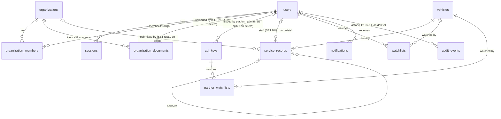

# Sijil - Architecture and Tech Stack

Status: starter specification for a three-week 42 ft_transcendence v21.2 project.

## Architecture principles
- One deployable FastAPI backend (modular monolith), not microservices.
- All public browser and partner API traffic uses HTTPS through Caddy.
- PostgreSQL owns relational data; MinIO owns private entity documents (licences); Redis supports background jobs and WebSocket fan-out.
- Service history is append-only. Corrections are new linked events, never edits to the original.
- Live updates (notifications, new records on an open timeline) reach every connected user over WebSocket (wss through Caddy).
- The app runs fully offline. The only outbound call is optional VIN decoding enrichment; nothing depends on it.
- Use demo vehicle data only. Do not imply official UAE, insurer, or government verification.

## Stack
| Layer | Technology | Purpose |
| --- | --- | --- |
| Web UI | React + Vite + TypeScript | Consumer, workshop, and admin interfaces |
| Styling | Tailwind CSS | Responsive UI and Arabic RTL layout |
| Backend | Python + FastAPI | REST APIs, business rules, authorization |
| ORM / migrations | SQLAlchemy 2 + Alembic | PostgreSQL models and schema migrations |
| Main database | PostgreSQL | Users, entities, VINs, history, audit and watchlists |
| Object storage | MinIO | Private entity licence and trade documents |
| Jobs | Celery + Redis | Notifications, import processing, optional PDF jobs |
| Real-time | FastAPI WebSockets + Redis pub/sub | Live notifications and timeline updates across connected users |
| VIN decoding | Offline decoder + NHTSA vPIC (optional) | Car details on VIN lookup, PDF and partner summary |
| Edge / TLS | Caddy | HTTPS and routing to frontend/backend |
| Infrastructure | Docker Compose | Single-command deployment |
| Testing | pytest + Playwright | Backend, concurrency and end-to-end tests |

## Service layout
```
Browser / API partner (admin-issued key)
             |
          HTTPS
             |
           Caddy
         /       \
   React UI     FastAPI API  ----(optional HTTPS)----> NHTSA vPIC
                   |  |  \
            PostgreSQL MinIO Redis -- Celery worker
```
- Caddy serves the React build and routes `/api/*` (including the `/api/v1/ws` WebSocket, upgraded to wss) to FastAPI.
- PostgreSQL, Redis, MinIO and Celery are internal to the Compose network; do not publish them directly.
- Caddy uses a trusted public certificate in hosted environments or a locally trusted certificate for demos.

## Core data model
- `users`: email, password hash, status, account details; **never** include ownership in public vehicle reports.
- `sessions`: authenticated sessions and expiration/revocation.
- `organizations`: dealership/workshop identity, registration, pending/approved/rejected status.
- `organization_members`: user, organization, role (entity_admin/entity_staff), membership status.
- `organization_documents`: organization, document type (trade licence, other), object key, file name, type/size, uploaded_by, deleted_at, deleted_by. Uploaded during registration; reviewed by the platform admin before approval; **deleted only by the platform admin**, with an audit event.
- `vehicles`: normalized unique VIN plus decoded fields: make, model, model_year, body_class, engine, `decode_source` (offline/vpic) and `decoded_at`.
- `service_records`: vehicle, organization, staff, category, predefined work codes, odometer, dates, flags, `corrects_record_id`, created_at. Append-only, with no file attachments. `organization_id`/`staff_id` are nullable (`ON DELETE SET NULL`) and the record stores a snapshot of the organization and staff names, so deleting an organization or user never rewrites history (the one deliberate duplicated field).
- `watchlists`: consumer, vehicle, notifications enabled.
- `notifications`: recipient, event type, payload, read status, created_at.
- `api_keys`: partner name, issued_by (platform admin), key prefix, hashed key, read-only scopes, last used, revoked_at and rate-limit identity. Not linked to any organization.
- `partner_watchlists`: API key, vehicle, label/preferences, last_checked_at.
- `audit_events`: actor, operation, target, timestamp and relevant change metadata.

Add proper foreign keys, unique constraints, indexes (VIN, records, organization, watchlist), and migrations. Prefer explicit relational constraints over duplicated fields.

### Entity-relationship diagram



Source of truth: `backend/app/models/` and `backend/alembic/versions/`.

### Pending migration (`0002`)
The initial schema (`0001_initial_schema.py`) predates three decisions, so a second migration is needed:
1. `api_keys.organization_id` is replaced by `partner_name` and `issued_by_id`; keys belong to named partners, not organizations.
2. `attachments` (linked to `service_records`) is replaced by `organization_documents` (linked to `organizations`).
3. `vehicles` gains `body_class`, `engine`, `decode_source` and `decoded_at` (make, model and model_year already exist).

Update the seed, factories and schema tests in the same change.

## Critical domain logic
1. Validate VIN format and normalize case at both frontend and backend; backend is authoritative.
2. Only an **approved** organization with an **active** authorized staff membership can append service records.
3. On record submission, run a PostgreSQL transaction: find/create vehicle safely, lock its vehicle row (`SELECT ... FOR UPDATE`), compare mileage with the latest effective reading, then append the record and any mileage flag atomically.
4. **Lower mileage is accepted but flagged** (not rejected). Consumer history and PDF display the record and a clear warning. Flagged entries are not silently hidden from history.
5. Corrections append a new event referencing the original; reports display both original and correction. Do not enable UPDATE/DELETE on service history through the app (enforce DB immutability where practical).
6. Organizations, users and organization documents can be **truly deleted** (required by the Organization system, Advanced permissions and File upload modules). Deleting an organization removes it with its memberships, staff access and documents; deleting a user removes the account and sessions. Their service records stay, showing the stored name snapshot with the reference set to NULL. Every deletion writes an audit event.
7. Only the **platform admin** can delete an organization document. Entities can upload and view their own documents but not delete them, so verification evidence cannot quietly disappear. The organization page shows "document removed" after a deletion.
8. **VIN decoding** never blocks a lookup. Decode offline first: manufacturer from the WMI (characters 1-3) and model year from character 10, plus a check-digit warning (warn, never reject; many non-North-American VINs do not use the check digit). If vPIC is reachable, call `DecodeVinValues` with a short timeout and cache the result on the vehicle row. GCC-spec cars may decode only partly.
9. Approval restricts who can submit records, but does **not** guarantee every submitted claim is true; label demo reports accordingly.

## Security and privacy
- Email/password login only for MVP; use Argon2id hashes and secure, HttpOnly, SameSite cookies with CSRF protection for state-changing requests.
- Backend checks role **and organization scope** on every protected action. No user may grant permissions they do not have.
- Validate payloads on both ends (FastAPI/Pydantic; typed frontend forms). Rate-limit auth and partner endpoints.
- Keep `.env` untracked; commit an `.env.example` with dummy variable names only. Never commit secrets or real credentials.
- Consumer history, PDFs and partner API responses contain only vehicle facts, decoded car details, organization name, timestamps and visible flags.
- Licence documents are visible only to the uploading organization's admins and to platform admins; never to consumers or partners.
- MinIO objects remain private and are accessed via authorized backend routes or short-lived scoped links.
- Partner API keys are read-only for vehicle data: they can never create, change or delete service records.
- No SMTP/email sending, email verification or email password reset in MVP. Staff onboarding uses admin-created accounts and one-time temporary credentials with forced password change.

## Developer / deployment contract
- API prefix: `/api/v1`; generate an OpenAPI specification from FastAPI. Agree on request and response schemas before building UI pages.
- Public partner API: `/api/partner/v1`, keys issued and revoked by the platform admin, shown once and stored hashed. Endpoints: GET `/vehicles/{vin}`, GET `/vehicles/{vin}/history`, GET `/watches`, POST `/watches`, PUT `/watches/{id}`, DELETE `/watches/{id}`. Rate limiting returns 429 with limit headers; missing or revoked keys return 401. Never use history mutation endpoints for the required PUT/DELETE actions.
- WebSocket: `/api/v1/ws`, authenticated with the session cookie. The backend publishes events (e.g. `notification.created`, `record.added`) to Redis pub/sub and every API instance fans them out to the connected clients it serves. Clients reconnect automatically and refetch on reconnect.
- `docker compose up --build -d` must start the full stack; initialization/migration should run automatically or as part of this one command.
- Provide `/health`. Write a seed script with approved demo entities, staff, licence documents, decoded vehicles, records and one demo partner key for evaluation.
- Suggested source layout: `backend/app/{api,auth,models,schemas,services,workers}`, `frontend/src/{components,pages,features}`, `infra/caddy`.
- Coordinate interface changes using documented migrations and typed API contracts; review changes in pull requests.
